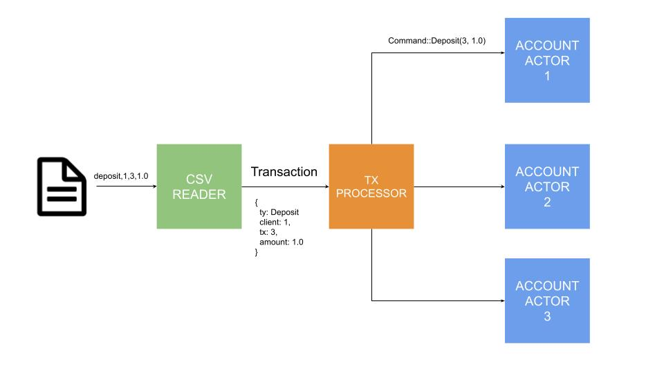

# ⚠️ This repo has been migrated ⚠️

Mainly for philosofic reasons I've decided to migrate all my projects to a free software alternative forge ([Codeberg](https://codeberg.org/)).

You can find the most recent version of this repository [here](https://codeberg.org/JasterV/transactions-processor).

I encourage any free software activist to follow the same steps, as it doesn't make sense to make use of a propietary software to host our projects if we advocate for free software.

# Transactions processor

> Process CSV data representing account transactions and display the accounts
> data

## Dependencies

- **tokio && tokio_stream**: Async runtime that allows us to solve the problem
  using concurrency and streams
- **csv_async**: Thanks to tokio_stream and this library we can read the CSV
  files using streams instead of writting the entire CSV on memory
- **serde**: This library offers an awesome api to easily convert strings to
  structured data.
- **thiserror & anyhow**: I like to use this libraries to handle errors on a
  cleaner way.
- **async-trait**: Since we implement the AsyncActor trait we need to use this
  library so rust can compile traits using async methods

## Architecture

This project is based on the
[Actor Model](https://www.brianstorti.com/the-actor-model/).

- Each actor run on its own thread (tokio tasks in this case)
- Actors do not share state
- Actors just receive messages and react to it
- Each actor has a mailbox (queue) from which it reads the messages in order.

### TxProcessor actor

This actor is responsible for processing `Transaction` objects, spawn new
Account actors if needed and send messages to them telling to perform any
action.

### Account actor

This actor is responsible for managing an `Account` object and a map of the
transactions done on that account.

### Why this architecture?

The Actors model offers a simple, clean and scalable way of building concurrent
systems. Because each actor owns its own resources without sharing it to the
outside world there is no need to use common concurrent techniques such as Locks
and it ensures to not have data races.

## Author

Víctor Martínez <jaster.victor@gmail.com>
